# Manual de Pulso Studio

Pulso Studio es una **groovebox para el móvil** que funciona en el navegador: baterías, bajos y sintes, patrones, piano roll, efectos y exportación a WAV, todo sin instalar nada.

Este manual explica cada pantalla con capturas. Las capturas usan la carátula **Neón**, pero todo funciona igual con las demás.

> **Versión:** en la pantallita de la app, arriba a la derecha, pone la versión que tienes cargada (por ejemplo `v2.86`).

<!--galeria-->
## Todas las vistas de un vistazo

**Crear**

<table>
<tr>
<td align="center" width="33%"><a href="#2-el-secuenciador">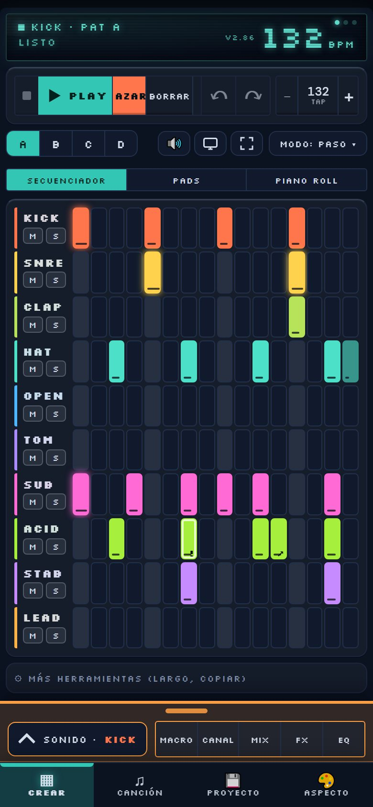 Secuenciador</a></td>
<td align="center" width="33%"><a href="#modos-de-paso">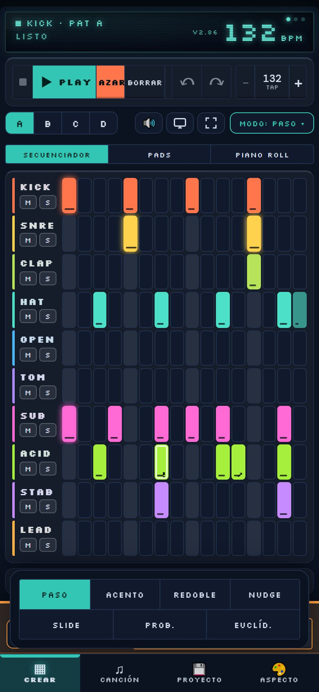 Modos de paso</a></td>
<td align="center" width="33%"><a href="#4-pads">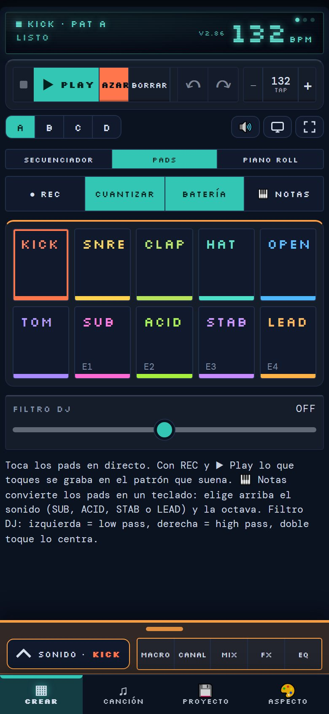 Pads · Batería</a></td>
</tr>
<tr>
<td align="center" width="33%"><a href="#modo-notas">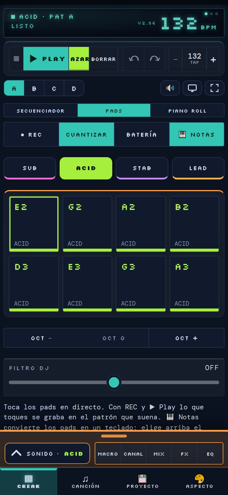 Pads · Notas</a></td>
<td align="center" width="33%"><a href="#5-piano-roll">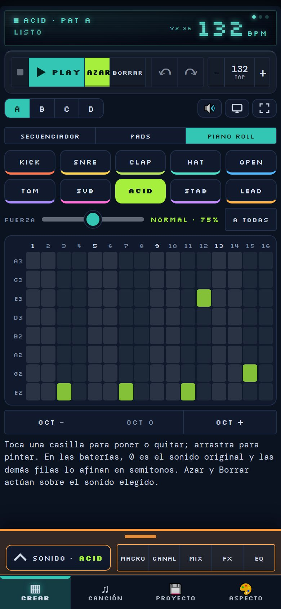 Piano roll · Melódico</a></td>
<td align="center" width="33%"><a href="#5-piano-roll">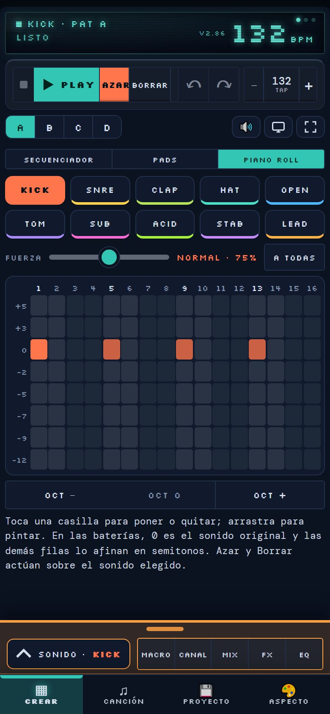 Piano roll · Batería</a></td>
</tr>
</table>

**Panel Sonido**

<table>
<tr>
<td align="center" width="33%"><a href="#81-macro">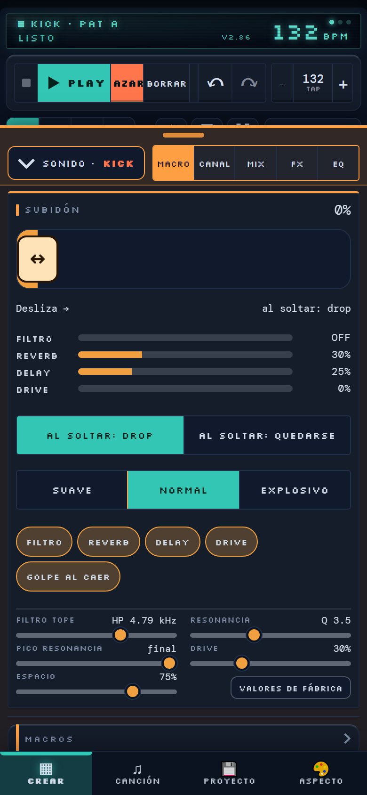 Macro (Subidón)</a></td>
<td align="center" width="33%"><a href="#82-canal">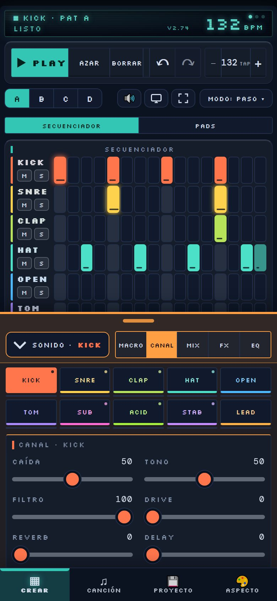 Canal</a></td>
<td align="center" width="33%"><a href="#83-mix">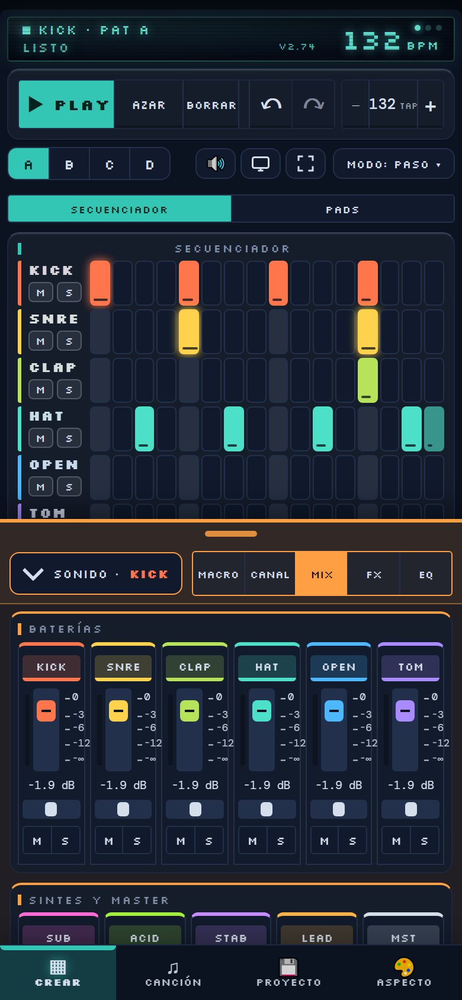 Mix</a></td>
</tr>
<tr>
<td align="center" width="33%"><a href="#83-mix">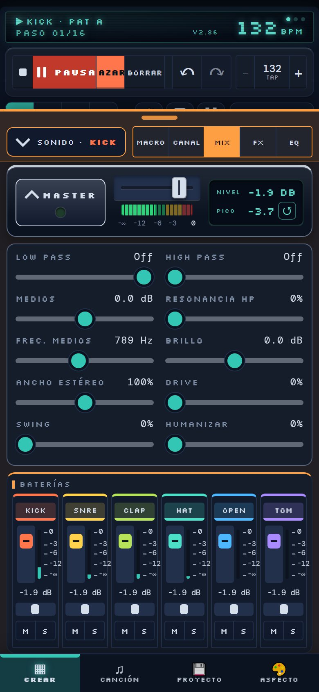 Mix · Master desplegado</a></td>
<td align="center" width="33%"><a href="#84-fx">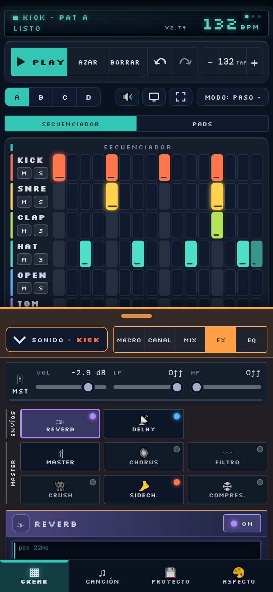 FX</a></td>
<td align="center" width="33%"><a href="#85-eq">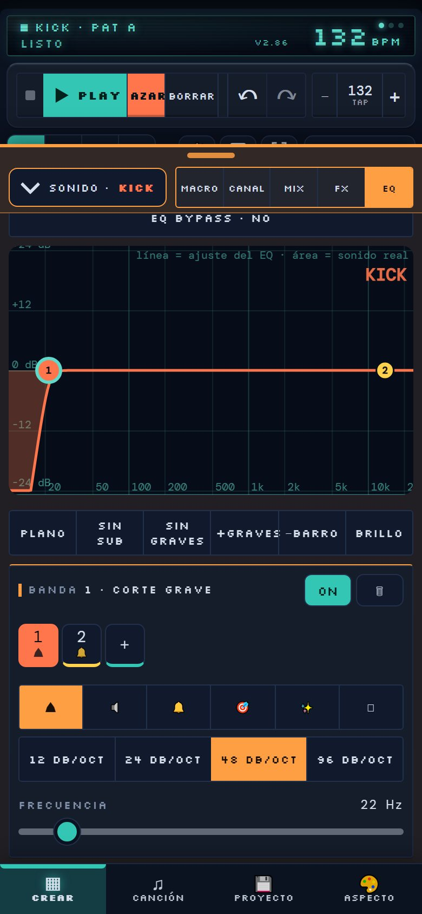 EQ</a></td>
</tr>
</table>
<!--/galeria-->

## 1. Primeros pasos

Abre la web en el navegador del móvil. Verás la pantalla de **Crear**: arriba la pantallita con el tempo, debajo los botones de transporte, la fila de patrones y la rejilla de pasos.

La pantalla se divide en cuatro zonas:

- **Pantallita (LCD):** muestra el canal y el patrón elegidos, el estado y el tempo en BPM. Desliza el dedo por ella para cambiar de patrón A–D. Toca para cambiar entre onda y espectro.
- **Transporte y patrones:** Stop, Play, Azar, Borrar, deshacer, rehacer, tempo y los patrones A B C D.
- **Vistas de Crear:** debajo de los patrones hay tres vistas: **Secuenciador** (la rejilla), **Pads** (tocar en directo) y **Piano roll** (dibujar notas).
- **Panel Sonido y barra inferior:** el panel Sonido (Macro, Canal, Mix, FX, EQ) y las cuatro pestañas **Crear, Canción, Proyecto y Aspecto**.

> **Consejo:** para usarla como una app, añade la web a la pantalla de inicio desde el menú del navegador. Se abre sin barras y a pantalla casi completa.

## 2. El secuenciador

La rejilla tiene **10 pistas**, una por fila: seis baterías (**KICK, SNRE, CLAP, HAT, OPEN, TOM**) y cuatro melódicas (**SUB, ACID, STAB, LEAD**). Cada fila tiene 16 pasos, que se reparten en cuatro tiempos.

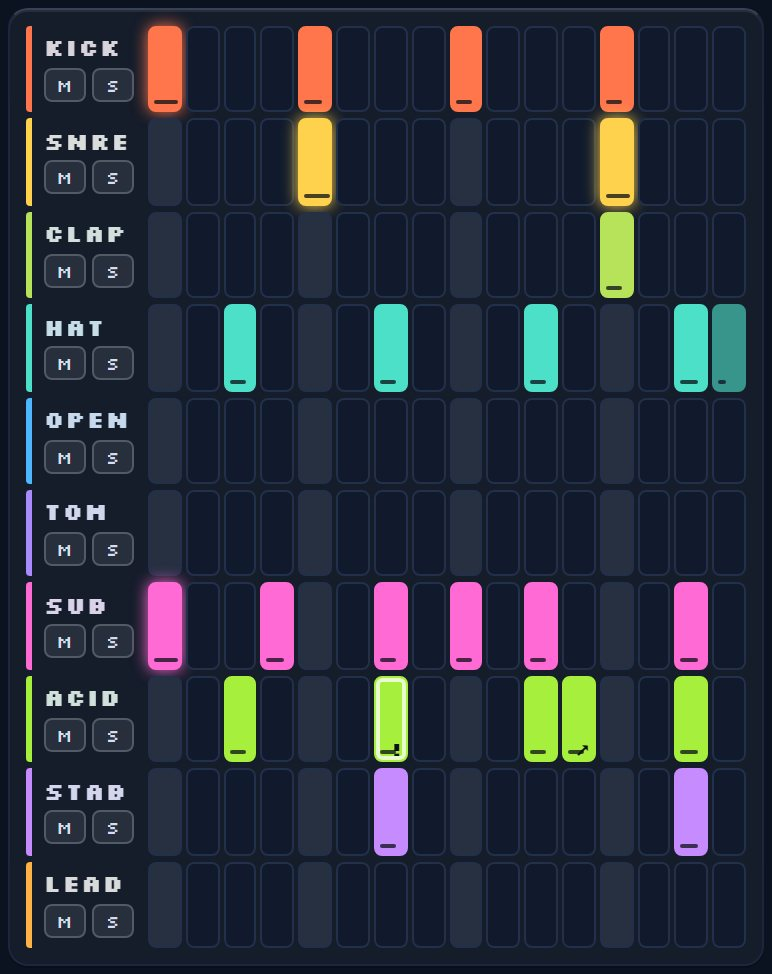

- **Tocar un paso** lo enciende o lo apaga.
- **Arrastrar en horizontal** pinta varios pasos de una pasada.
- **Mantener pulsado** un paso encendido cambia su fuerza (suave, normal o fuerte).
- **M** silencia la pista (mute) y **S** la deja sola (solo).
- **Tocar el nombre** de la pista la elige: los controles del panel Sonido, el color del botón Azar y el ecualizador pasan a ese canal.
- En las pistas melódicas, la fila **NOTA** debajo de la rejilla elige la nota de cada paso.

### Modos de paso

El botón **Modo: Paso** abre una hoja con lo que hace tocar un paso. Con cada modo, tocar un paso encendido le añade algo:

- **Paso:** enciende y apaga.
- **Acento:** el paso suena más fuerte.
- **Redoble:** el golpe se repite dentro del paso (×2, ×3, ×4).
- **Nudge:** adelanta o retrasa un poco el golpe.
- **Slide:** enlaza una nota con la siguiente. Solo en ACID.
- **Prob.:** probabilidad de que el paso suene.
- **Euclíd.:** reparte los golpes de forma uniforme por el patrón.

### Más herramientas

Bajo la rejilla, **Más herramientas** guarda funciones menos frecuentes:

- **LEN:** cambia el largo de la pista elegida. ACID puede tener hasta 32 pasos, con dos páginas (1–16 y 17–32).
- **Pista / Patrón / Pegar:** copia la pista o el patrón entero y lo pega en otro sitio.

## 3. Transporte y herramientas rápidas

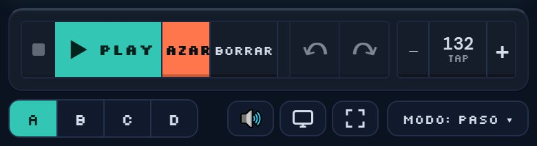

- **Stop (el cuadrado, a la izquierda de Play):** para el sonido y vuelve al principio.
- **Play / Pausa:** Play reproduce. Mientras suena, el botón pasa a **Pausa** (en rojo). Pausar **deja el paso donde estaba**, con la posición iluminada, y Play sigue desde ese mismo paso. Para volver al principio, usa Stop.
- **Azar:** **muta** la pista elegida: cambia solo unos pocos pasos (cerca del 20 %) y deja el resto. Si la pista está vacía, genera un patrón nuevo con la escala del proyecto. El botón toma el color de la pista elegida. Se puede deshacer.
- **Borrar:** vacía la pista elegida del patrón actual.
- **Deshacer y rehacer:** ver más abajo.
- **Tempo:** `−` y `+` cambian el BPM de uno en uno. Toca el número varias veces al ritmo que quieras para marcar el tempo (**TAP**). El tempo por defecto es **132**.
- **A B C D:** los cuatro patrones. El patrón que suena lleva una marca.
- **Altavoz:** si está resaltado, el sonido de pulsar un paso está apagado.
- **Escenario:** esconde herramientas para tocar en directo con las casillas grandes. Se sale con **Salir**.
- **Pantalla completa:** oculta las barras del navegador. **En iPhone no existe**, porque Apple no lo permite en páginas web; usa «Añadir a pantalla de inicio».
- **Modo:** la hoja de los modos de paso.

### Deshacer y rehacer

Deshacer y rehacer guardan **todo el proyecto**, no solo las notas: secuencia, canales, mezcla, FX, EQ de canal y de master, canción, tempo y escala.

- Hasta **100 pasos** hacia atrás.
- Mover un deslizador **sin soltar** cuenta como un solo paso, aunque hagas pausas.
- Grabar con los pads es un solo paso.
- El mensaje de la pantallita dice qué se deshizo: SECUENCIA, MEZCLA, FX, EQ…
- **No entran** la carátula, el estilo, las luces, el audio ni Play, Pausa y Stop.

## 4. Pads

La vista **Pads** es para tocar en directo. Tiene dos modos: **Batería** y **Notas**.

- **Batería:** diez pads, uno por canal. Cada pad toca su sonido.
- **● REC:** con Play activo, lo que toques se **graba** en el patrón que suena. Toda la grabación se deshace de una vez.
- **Cuantizar:** ajusta lo grabado al paso más cercano. Apagado, guarda la posición exacta.
- **Filtro DJ:** a la izquierda es un filtro de agudos (low pass) y a la derecha un filtro de graves (high pass). Doble toque lo centra.

### Modo Notas

**🎹 Notas** convierte los pads en un teclado de ocho notas de la escala.

- **Elige el sonido arriba:** SUB, ACID, STAB o LEAD, cada uno con su color. Los pads tocan las notas de ese sonido.
- **OCT − / OCT +:** sube o baja una octava. SUB no baja de la octava 0, porque sonaría por debajo de lo audible.
- Con **REC**, la octava elegida se graba también.

## 5. Piano roll

El piano roll sirve para **escribir** melodías y ritmos viendo las notas. Se abre desde la vista **Piano roll** de Crear.

- **Elige el sonido** en los diez botones de arriba: cuatro melódicos y seis baterías.
- Cada **fila** es una nota de la escala del proyecto y cada **columna** un paso. En ACID, con 32 pasos, aparecen dos páginas (1–16 y 17–32).
- **Tocar una casilla** pone o quita la nota. **Arrastrar** pinta o borra varias seguidas.
- Hay **una nota por paso** y cada nota dura un paso. No hay acordes.
- **OCT − / OCT +** cambia el rango de octavas que ves. Si una nota queda fuera, se ve atenuada en la fila más cercana.
- Con Play, un cursor recorre las columnas.

**Baterías.** Una batería no tiene notas, así que cada sonido tiene su propia escala de **afinación en semitonos**. La fila **0** es el sonido original; las de arriba suenan más agudas (+) y las de abajo más graves (−).

**Fuerza de las notas nuevas.** La barra **Fuerza** tiene tres posiciones: suave (45 %), normal (75 %) y fuerte (100 %). Lo que pintes a partir de ese momento sale con esa fuerza. Las notas flojas se ven más transparentes. El botón **A todas** aplica la fuerza elegida a todas las notas del sonido (se puede deshacer).

> **Azar y Borrar** de arriba actúan sobre el sonido elegido. Dentro del piano roll, Azar usa la fuerza de la barra para las notas nuevas.

## 6. Canción

Aquí se monta el tema encadenando patrones.

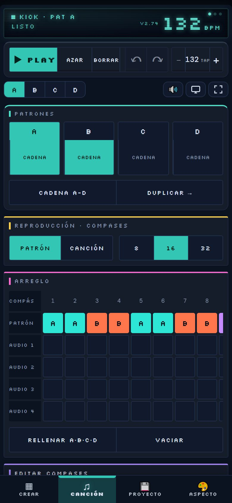

- **Reproducción:** **PATRÓN** repite el patrón elegido; **CANCIÓN** toca el arreglo compás a compás. El largo es de 8, 16 o 32 compases.
- **Arreglo:** cada casilla es un compás. Tócala para cambiar de patrón (A → B → C → D → vacío). **Mantén pulsada** una casilla para abrir ese patrón y editarlo.
- **Rellenar A·B·C·D** y **Vaciar** rellenan o limpian el arreglo entero.
- **Editar compases:** copiar, mover o repetir un compás. Cada acción se puede deshacer ahí mismo.
- **Cadena A-D:** encadena los cuatro patrones sin entrar en el modo canción.
- **Pistas de audio:** puedes cargar audios que suenan en los compases que marques y se ajustan al tempo según su BPM original.

## 7. Proyecto

Guarda, comparte y exporta lo que has hecho.

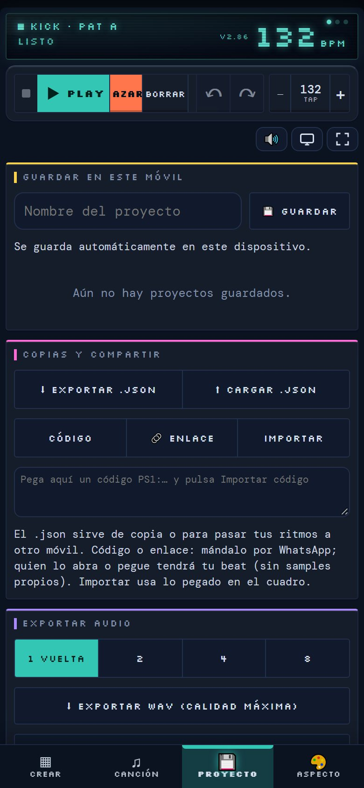

- **Guardar en este móvil:** ponle nombre y pulsa **Guardar**. Además la app se guarda sola en este dispositivo cada vez que cambias algo.
- **Exportar .json / Cargar .json:** copia de seguridad del proyecto, o para pasarlo a otro móvil.
- **Código y Enlace:** genera un código o un enlace que puedes mandar por WhatsApp. Quien lo abra o pegue tendrá tu beat. No incluye samples propios.
- **Importar:** carga el código pegado en el cuadro.
- **Exportar audio:** elige 1, 2, 4 u 8 vueltas y pulsa **Exportar WAV**. Se calcula al instante, sin cortes, a 16 bits y a la frecuencia de tu móvil.
- **Grabar en tiempo real (.webm):** graba lo que suena mientras suena.

Los proyectos guardados con versiones anteriores se abren sin problema: la app los adapta sola al abrirlos.

## 8. El panel Sonido

Bajo la rejilla siempre está el panel **Sonido**. Tócalo (la flecha) para abrirlo o cerrarlo. Arrastra la **asa** de arriba para cambiar su altura; doble toque la deja en la altura normal. Tiene cinco pestañas: **Macro, Canal, Mix, FX y EQ**.

### 8.1 Macro

Dos cosas: el **subidón** y los **seis macros**.

**Subidón.** Un deslizador grande que mueves tú. Cuanto más a la derecha, más suben a la vez el **filtro de graves**, la **reverb**, el **delay** y el **drive**. Las barritas de debajo muestran cada uno en vivo.

- **Al soltar: Drop** vuelve todo de golpe a como estaba y suena un golpe. **Quedarse** deja el deslizador donde lo sueltes.
- **Curva:** Suave (sube pronto), Normal o Explosivo (sube al final).
- **Chips:** elige qué sube (Filtro, Reverb, Delay, Drive) y si quieres el **Golpe al caer**.
- **Volumen estable:** mientras mueves la barra, la app vigila el volumen y lo corrige sola para que se mantenga parecido al de antes. Al soltar vuelve al nivel de antes. Al final de la barra el filtro quita casi todos los graves y el volumen baja de forma natural.

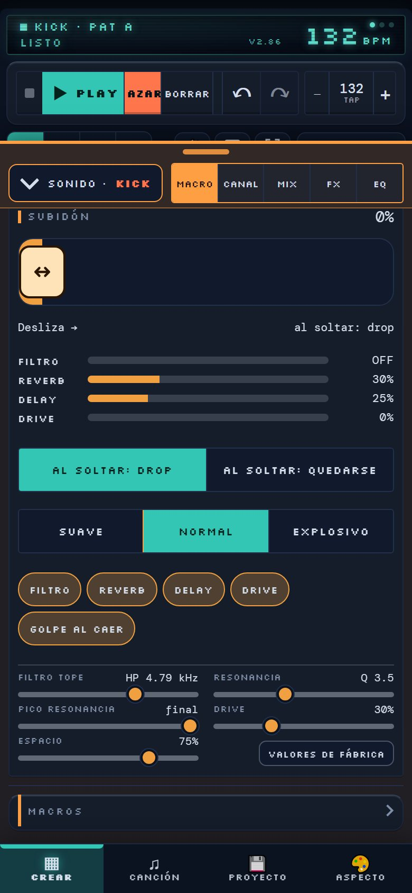

Debajo hay **cinco ajustes** para dejar el subidón a tu gusto:

- **Filtro tope:** hasta qué frecuencia sube el filtro (de 1 a 10 kHz).
- **Resonancia:** cuánto silba el filtro al subir.
- **Pico resonancia:** en qué punto del recorrido es más fuerte (inicio, mitad o final).
- **Drive** (por defecto 30 %) y **Espacio:** hasta dónde suben el drive y la reverb con el delay.
- **Valores de fábrica** los restaura. Doble toque en un ajuste lo devuelve a su valor.

**Los seis macros** (DJ, Reverb, Delay, Drive, Sidechain y Master) están plegados bajo el nombre **Macros**. Tócalo para desplegarlos. Doble toque en un deslizador lo reinicia.

### 8.2 Canal

Todo sobre el canal que has elegido.

- **Chips de canales:** cambia de canal. Cada uno tiene su **M** y su **S**.
- **Controles:** **Caída** (cuánto dura el sonido), **Tono**, **Filtro**, **Drive**, **Reverb** y **Delay** (los dos últimos son envíos).
- **Kits de sonido:** para las baterías, cambian tono, caída, filtro, drive y envíos de las 6 a la vez (Original, 808, 909, Lo-fi, Seco, Techno).
- **Presets:** en los sintes (SUB, ACID, STAB, LEAD) hay presets de sonido.
- **Capas:** suma una segunda voz al canal (por ejemplo Kick + Tom, o un sinte con su octava).
- **Sample propio:** carga un audio de hasta 8 segundos. Se guarda en este móvil.
- **Mis kits guardados:** guarda y recupera tus ajustes de baterías.
- **SUB y sintes:** onda (Sin, Tri, Saw, Sqr), tono y escala, y **Capa +1 octava**.

### 8.3 Mix

El mezclador. De arriba abajo: el **Limitador**, el **Master**, y después los canales.

**Limitador.** Es un limitador de picos: lo que pase de cierto nivel se atenúa, y lo que no llega, pasa sin cambios. Se pliega tocando su nombre. Tiene dos barras:

- **TECHO** (de −12 a 0 dBFS, por defecto −1 dB): el nivel máximo que dejará pasar. Solo atenúa lo que se pase de ahí.
- **ENTRADA** (de 0 a +12 dB, por defecto 0 dB): sube la señal antes de limitar. Solo subes el volumen si tú lo pides, y se ve el valor.
- **Vúmetro ENTRADA:** muestra el nivel que llega al limitador, de −48 a +12 dB. La raya fina es 0 dB y la gruesa es donde empieza a limitar. Cuando el limitador atenúa, la barra se pone naranja y sale la reducción en dB (**RED.**). Pasar de 0 dB aquí no es un fallo: el limitador lo recoge.
- **Doble toque** en una barra la devuelve a su valor por defecto.

**Master.** Una placa propia, tumbada, bajo el limitador.

- **Placa MASTER:** toca la placa para **mostrar u ocultar los ajustes del master** (Low pass, High pass, Medios, Resonancia HP, Frec. medios, Brillo, Ancho estéreo, Drive, Swing y Humanizar). Son los mismos de FX → Master, y se mueven a la vez. Doble toque restablece cada ajuste.
- **LED de la placa:** apagado cuando todo va bien, **naranja** si el limitador trabaja bastante o el master empieza a saturar, y **rojo** si distorsiona.
- **Fader horizontal, medidor de LEDs y escala en dB:** el volumen del master y su nivel.
- **NIVEL y PICO:** el pico es el valor más alto que ha pasado por el master desde la última vez. El botón **↺** lo reinicia. Solo mide con la pestaña Mix abierta.

**Canales.** Baterías y Sintes tienen cada uno su tira:

- **Fader:** el volumen del canal, con el medidor y la escala en dB al lado.
- **Pan:** reparte el sonido entre izquierda y derecha.
- **M y S:** mute y solo.
- **Toca el nombre** para abrir ese canal en la pestaña Canal.
- **Doble toque** en un fader o en el pan lo reinicia.

### 8.4 FX

Los efectos, organizados como una cadena de módulos.

- **Tira de módulos:** **Envíos** (Reverb, Delay) y **Master** (Master, Chorus, Filtro, Crush, Sidechain, Compresor). Toca un módulo para ver solo ese efecto.
- **LED de cada módulo:** enciende o apaga el efecto sin cambiar de efecto.
- **Reverb y Delay** son **envíos**: se mandan desde cada canal con el control Reverb o Delay de la pestaña Canal.
- **Chorus/Flanger, Filtro LFO, Bitcrusher y Compresor** actúan sobre toda la mezcla.
- **Sidechain:** el kick baja el volumen de los canales marcados, para que los graves respiren.
- **Master:** filtros (con **Resonancia LP** y **Resonancia HP**), medios, brillo, ancho estéreo, drive, swing, humanizar, **Limitador: techo**, **Limitador: entrada** y volumen.
- **Doble toque** en un control lo devuelve a su valor. Por defecto el drive del master está en 0 % y la ganancia del compresor en 0 dB.

### 8.5 EQ

El ecualizador, por canal y para el master.

- Elige arriba el canal (o MST para el master). El **nombre del sonido** sale arriba a la derecha de la gráfica.
- **Lectura de la gráfica:** la línea gruesa es el ajuste del EQ y el área de fondo es el sonido real. El eje de +24 a −24 dB es cuánto sube o baja cada banda; no es el nivel de salida del master.
- Cada canal tiene hasta **8 bandas**. Toca **＋** o haz doble toque en la curva para crear una; arrastra su punto para cambiar frecuencia y ganancia.
- **Tipos de banda**, ordenados de graves a agudos: corte grave, shelf grave, campana, notch, shelf agudo y corte agudo.
- **Notch con profundidad:** tiene un deslizador de **Profundidad** de −0,5 a −24 dB. −24 dB es el notch total; con menos profundidad se parece a una campana estrecha de corte.
- **Ajustes rápidos**, justo bajo la gráfica: **Plano** deja las bandas a 0 dB sin borrarlas (los cortes y el notch se quedan apagados), y **Sin sub, Sin graves, +Graves, −Barro y Brillo** añaden una banda lista.
- **ON** enciende o apaga la banda elegida; el cubo la borra.
- **Sin bandas, sin filtros:** un canal sin bandas no gasta recursos. Al añadir o encender una banda, el bypass se apaga solo.
- **EQ BYPASS** apaga toda la ecualización para comparar.

## 9. Aspecto

Esta pestaña cambia cómo se ve la app y da acceso a este manual.

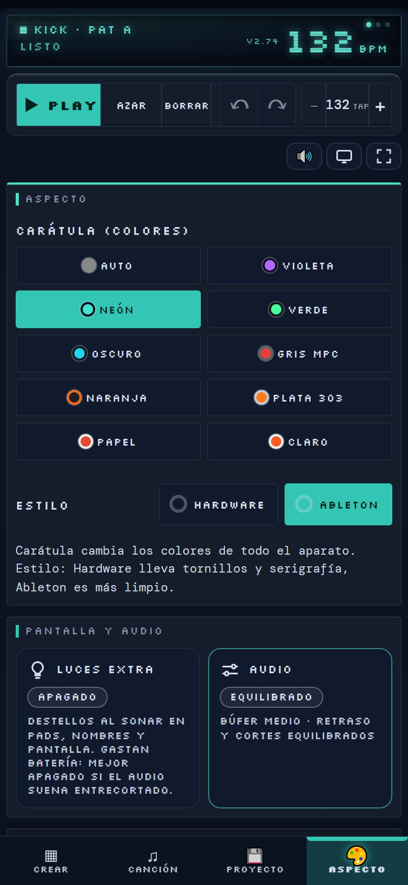

- **Carátula (colores):** diez carátulas, ordenadas de la más oscura a la más clara. **Auto** sigue el modo claro u oscuro de tu móvil.
- **Estilo:** **Hardware** (con tornillos y serigrafía) o **Ableton** (más limpio).
- **Luces extra:** destellos al sonar en pads, nombres y pantalla. Gastan batería, así que viene **apagado**. Si el audio suena entrecortado, déjalo apagado.
- **Audio:** **Rápido**, **Equilibrado** o **Estable**. Es el tamaño del búfer de audio: más búfer, más retraso al tocar pero menos cortes. El cambio se aplica **al recargar** la página.
- **Ayuda · Abrir el manual:** el botón que abre este manual, al final de la pestaña.

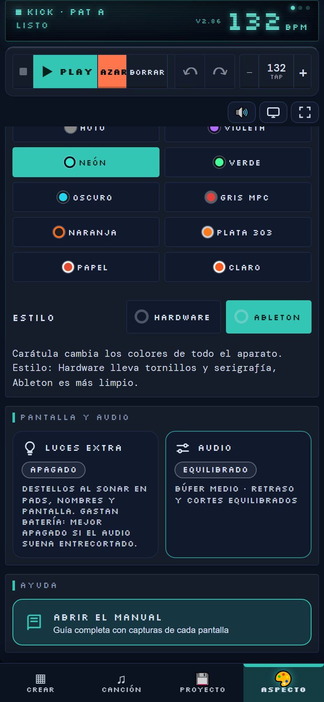

## 10. Consejos y problemas habituales

**El audio se corta o chisporrotea.**
- En Aspecto, pon **Audio: Estable** y recarga la página.
- Deja **Luces extra** apagado.
- Cierra otras pestañas y apps que consuman.

**Los graves del kick suenan flojos.**
- El Sidechain debe estar encendido: es el que aparta el sub y el acid del kick.
- Prueba a silenciar ACID o a quitar la **Capa +1 octava** del SUB para ver cuál tapa.
- Los altavoces del móvil casi no reproducen graves; con auriculares se nota mucho más.

**El LED del master se pone naranja o rojo, o el sonido distorsiona.**
- Mira el Limitador de Mix. Si **ENTRADA** muestra una reducción (RED.) alta, el limitador está atenuando mucho.
- Baja un poco los faders de los canales, o baja la barra **ENTRADA** del limitador. Bajar el fader del master no lo evita, porque actúa después.
- Si quieres un límite más bajo, baja el **TECHO**.

**Los números de los medidores no coinciden entre sí.**
- Cada uno mide un punto distinto. El vúmetro de un canal mide solo ese canal, ya con su fader. La entrada del limitador mide la suma de todos los canales y efectos, antes del limitador. El master mide lo que sale, ya con su fader. Por eso un canal a −6 dB puede acabar con una suma que pasa de 0 dB antes del limitador y un pico del master cerca de −3 dB.

**No veo la última versión.**
- La página se guarda unos minutos en el móvil. Cierra la pestaña y vuelve a abrirla.
- La versión cargada aparece arriba en la pantallita.

**No encuentro pantalla completa en iPhone.**
- Apple no la permite en páginas web. Usa «Añadir a pantalla de inicio» desde el botón de compartir de Safari.

**¿Se pierde mi trabajo?**
- La app guarda sola en este móvil. Si cambias de móvil o borras los datos del navegador, **exporta un .json** o un código antes.
- Los samples propios no entran en el .json ni en el código.

**Me equivoqué con un deslizador o con un cambio.**
- Usa **Deshacer** (la flecha). Guarda hasta 100 pasos de todo el proyecto.

---

El código y el historial de cambios están en GitHub: <https://github.com/djsergiostylo/pulso-studio-claude>.
